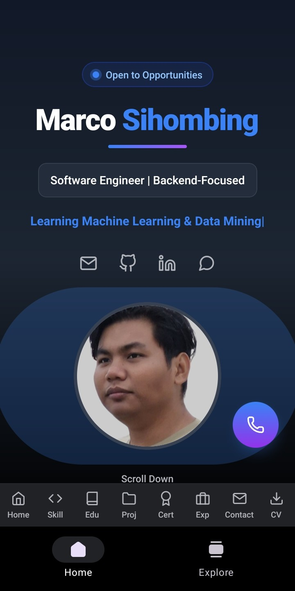

# Marco — Mobile Portfolio

A personal portfolio application built with **Expo** and **React Native**, showcasing my projects, technical skills, experience, education, and certificates.

This application is developed iteratively, with improvements in user experience, animations, responsiveness, and cross-platform support.

## Versions

### V1 — Android Portfolio

The first version of my mobile portfolio, developed for Android.

- Personal profile and introduction
- Projects showcase
- Technical skills
- Work experience and education
- Certificates
- Contact information

**Download:** [V1 Android APK — Google Drive](https://drive.google.com/file/d/1oc-5jFdOVR4RRZrEgFjsla4neoZQtJKO/view?usp=sharing)

#### Screenshots


---

### V2 — Enhanced Experience "Next UPDATE"

The second version focuses on a smoother, more refined, and modern mobile experience.

- Smoother animations and transitions
- Improved UI and navigation
- Better responsiveness
- Enhanced user experience
- Android and iOS support

## Tech Stack

- React Native
- Expo
- TypeScript
- Expo Router

## Development

```bash
npm install
npx expo start
```

To run on Android:

```bash
npx expo start --android
```

To run on iOS:

```bash
npx expo start --ios
```

## About

This project represents my journey in mobile application development, from the initial Android implementation to a more polished cross-platform experience.

Built and maintained by **Marco Sihombing**.
